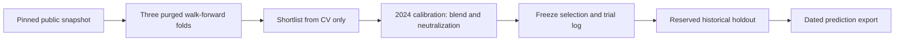

# Numerai Solstice

[](https://github.com/Noptus/numerai-solstice/actions/workflows/tests.yml)

Reproducible **Numerai v6** research on a local CPU: purged walk-forward validation, official neutral correlation, fixed-benchmark contribution, and a recorded model-selection process.

AI-assisted implementation. The repository makes its data, tests, search budget and evaluation boundaries inspectable. Historical tournament scores do not establish live investment performance.

## Measured reference

The first frozen study scored **0.01689 mean NCORR** across 59 historical evaluation dates, versus **0.00410** for its simple baseline and **0.02784** for the public benchmark. The custom blend improved on its control and still lagged the stronger benchmark. [Complete results, uncertainty and all trials](reports/README.md).

A trusted model bundle produced **7,153 dated predictions in 0.364 seconds** inside the inference function, including integrity checks and file loading. This is a local timing on the reference Mac, not a live investment result. An expanded full-feature follow-up is in progress; the same historical period is now exploratory.

## Run it

Python 3.12+, macOS or Linux, and [uv](https://docs.astral.sh/uv/getting-started/installation/). The default experiment uses six CPU threads, one model at a time and at most 1,500 training observations per date. The measured reference machine has 32 GiB RAM. Raw data and model artifacts stay outside Git.

```bash
git clone https://github.com/Noptus/numerai-solstice.git
cd numerai-solstice
uv sync --frozen --extra dev --no-editable
uv run --frozen --no-editable solstice plan --config configs/mac.toml
uv run --frozen --no-editable pytest

# Public datasets; no account credentials required. Pins the round on first use.
uv run --frozen --no-editable solstice download --include-live

# All stages, with integrity-checked checkpoints for resuming the same run.
uv run --frozen --no-editable solstice run --output runs/mac-v6
```

Download size, model fit times, historical scores and uncertainty are recorded in the [reference experiment](reports/README.md). Budget several hours for a new machine; the CLI logs each fit and stage. Stop and resume the same command without discarding completed fits. Changing code, dependencies, configuration or snapshot requires a fresh run directory.

## Research design



| Component | What is compared or enforced |
| --- | --- |
| Baselines | Small-feature LightGBM and medium-feature ridge regression |
| Tree candidates | Regularization, extra trees, slower learning and recency weighting |
| Target diversity | Explicit Jupiter, factor-feature-neutral and Camille 60-day targets |
| Era boosting | Recorded in-sample reweighting ablation; no assumed benefit |
| Sampling | Deterministic ticker/date hashes, independent of labels |
| Validation | Earlier dates only; 90 business days purged before every outer and inner evaluation boundary |
| Early stopping | Separate purged block inside training; outer labels never select tree counts |
| Ensemble | CV shortlist; nonnegative greedy blend and exposure neutralization tuned on calibration only |
| Scoring | NCORR and contribution to `lgbm_jupiter_60`, using supplied v6 neutralizers |
| Evidence | Per-date scores, every calibration trial, SHA-256 data/model hashes and dependency versions |

The purge covers the explicit 60-day targets, the documented lag, and a conservative buffer. It uses weekdays rather than a bespoke exchange calendar. Scores use every eligible stock in each evaluation date; only training is sampled. Numerai's `data_type=test` rows are excluded.

The reserved holdout is historical public data, not a claim that nobody has previously examined it. Opening it consumes it. A better score after changing the design needs fresh prospective evidence. Block-bootstrap intervals use 16-date blocks to reflect overlapping outcomes approximately; they are not a guarantee of independence.

## Inspect the implementation

| Path | Purpose |
| --- | --- |
| [`configs/mac.toml`](configs/mac.toml) | Finite nine-candidate CPU experiment and fixed date windows |
| [`research/data.py`](research/data.py) | Pinned downloads, SHA-256 integrity, schema and key validation |
| [`research/validation.py`](research/validation.py) | Date purging, deterministic sampling and weighting |
| [`research/models.py`](research/models.py) | Training-only preprocessing, inner stopping and model fits |
| [`research/scoring.py`](research/scoring.py) | Official-metric parity, reusable neutralizer factorization and uncertainty |
| [`research/runner.py`](research/runner.py) | Checkpoints, staged selection and holdout access journal |
| [`tests/`](tests/) | Numerical parity, isolation failures and real synthetic-data CPU integration |
| [`docs/RESEARCH.md`](docs/RESEARCH.md) | Technique sources, assumptions and next experiments |

The supplied plan loads the medium feature set for exposure postprocessing. Custom plans must retain a medium-feature candidate so those columns remain available.

Individual stages are available as `solstice train --stage cv`, `score --stage cv`, `train --stage calibration`, `score --stage calibration`, `select`, and `finalize`. Use the same `--config`, `--data` and `--output` throughout. Running `finalize` again returns its saved result rather than evaluating the holdout again.

A prediction export refits the frozen selection on eligible history from the pinned round:

```bash
uv run --frozen --no-editable python -m scripts.export_live \
  --run runs/mac-v6 --output runs/mac-v6/live-export
```

After that export, inference can use a separate live-only snapshot with no training labels or refit:

```bash
uv run --frozen --no-editable python -m scripts.download_live --data data/next-live
uv run --frozen --no-editable python -m scripts.predict_bundle \
  --bundle runs/mac-v6/live-export --data data/next-live \
  --output runs/next-live-predictions.csv
```

Use a fresh data directory for each new round; existing snapshots stay pinned. Inference verifies model, source, dependency and live-file hashes and preserves every ticker/date key.

The export writes dated ticker/date predictions and an integrity manifest. It does not upload, stake or trade. A historical snapshot is not a current-round submission. Check current Numerai requirements before independently arranging deployment. Pickled models are local trusted artifacts; do not load checkpoints from untrusted sources.

## Compatibility and reuse

The v6 path uses `date` / `numerai_ticker`, explicit `target_jupiter_60`, numeric feature sets and supplied neutralizer matrices. Text `feature_country` is excluded. Restored continuous features may contain missing values: ridge fits its imputer/scaler on training only; trees use native missing-value handling.

The original `solstice.py`, `config.py` and `validation.py` remain as a **legacy v5.2 research implementation**, documented in [the legacy guide](docs/LEGACY_V5.md). Its Spearman diagnostics are not v6 NCORR. Public v5 training downloads were retired; that path needs cached compatible data and its older optional dependencies. Use the `solstice` console command or `python -m research` for v6.

No standalone source license has been granted in this repository. Dataset and dependency licenses remain with their owners.
