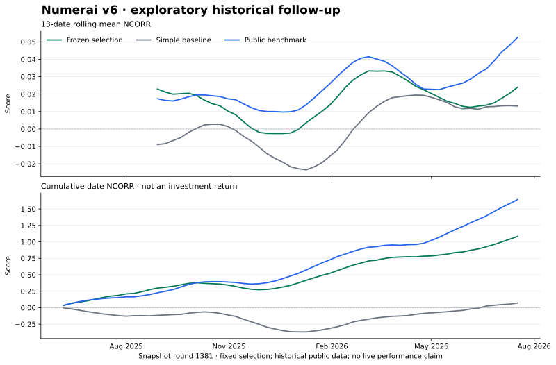

# Numerai v6 exploratory follow-up

Completed 2026-10-22 on **Apple M5**, 32 GiB RAM, using **6 CPU threads**. Public snapshot round **1381**; **7** predeclared candidates and **3** purged walk-forward folds. AI-assisted implementation.

## Reused historical evaluation

This evaluation period was already inspected in the first study. Results below are exploratory, and their intervals do not establish independent improvement.

**2025-06-06 through 2026-07-17**, 59 evaluation dates. All eligible stocks are scored on the same dates. Scores are not trading returns.

| Model | Mean NCORR | 95% interval for mean NCORR | Mean fixed-benchmark contribution |
| --- | ---: | --- | ---: |
| Frozen selection | 0.018367 | [0.009031, 0.026328] | -0.001341 |
| Simple small-feature baseline | 0.001199 | [-0.010371, 0.012209] | -0.007493 |
| Public `lgbm_jupiter_60` | 0.027842 | [0.017444, 0.039531] | 0.000000 |

Against the simple baseline, the paired mean NCORR difference is **+0.017168** (95% block-bootstrap interval [+0.007655, +0.025918]). This is a descriptive interval on reused historical data, not an independent improvement test.

Against the public benchmark, the paired mean NCORR difference is **-0.009475** (95% block-bootstrap interval [-0.017715, -0.002671]). This is a descriptive interval on reused historical data, not an independent improvement test.



Intervals use 16-date circular blocks and 2,000 draws. They approximate serial dependence from overlapping 60-day outcomes; they do not correct for every research decision or establish a live edge. Contribution is measured against the fixed public benchmark, whose contribution to itself is zero, rather than Numerai's changing meta-model.

## Selection and evaluation access

CV ranking: mean NCORR minus 0.25 × between-date standard deviation. The shortlist was **full-slow, full-balanced, full-factor-target, balanced-medium, slow-medium**. Calibration used 2024-01-05 through 2024-12-27 with **65 recorded trials**; the later evaluation starts only after a further maturity gap.

Selected weights: **`full-factor-target` 18.2%, `full-slow` 63.6%, `slow-medium` 18.2%**. Feature-neutralization proportion: **0.50**, against the top 50 contemporaneously exposed medium-set numeric features, chosen without targets.

The [selection](wide-v6-1381/selection.json), [complete calibration trial log](wide-v6-1381/calibration_trials.json) and [holdout access journal](wide-v6-1381/holdout_access.json) record this run's sequence. This period was already consumed in the first study; a new access journal does not make it fresh. Changing the model after reading these results requires fresh prospective evidence; public historical data is not guaranteed never to have informed earlier work.

## All walk-forward candidates

These are the complete CV results, including losing candidates. Tree counts were selected using purged inner stopping blocks, then the models were refitted on eligible training observations. The baseline is our small-feature control, not an exact reproduction of Numerai's 200,000-row example.

| Candidate | Mean NCORR | Date-score std | Mean benchmark contribution | CV fit minutes |
| --- | ---: | ---: | ---: | ---: |
| `full-slow` | 0.031738 | 0.018577 | 0.004237 | 3.84 |
| `full-balanced` | 0.029127 | 0.016541 | 0.004507 | 2.25 |
| `full-factor-target` | 0.027858 | 0.021205 | 0.008200 | 3.18 |
| `balanced-medium` | 0.026049 | 0.015971 | 0.001516 | 1.43 |
| `slow-medium` | 0.020888 | 0.018720 | 0.000384 | 2.31 |
| `ridge-medium` | 0.015360 | 0.015096 | -0.002327 | 0.80 |
| `baseline-small` | 0.009241 | 0.012348 | -0.000081 | 0.18 |

## Measured compute and data

- Research wall time: **28.4 minutes**, including sampling, prediction, scoring and calibration; excludes download and later export/reporting.
- Model fits: **31**, totaling **23.8 fit minutes**. [Fit metadata](wide-v6-1381/model_fits.json) includes row counts, dates, tree counts, seeds and hashes.
- Largest fit: **864,000** training observations; deterministic cap of **750** per date. Evaluation stocks were not sampled.
- Snapshot files: **7.69 GiB**, including supplied neutralizers and the dated live preview.
- Source, exact dependency versions, complete configuration and dataset hashes: [frozen plan](wide-v6-1381/plan.json). Training source commit: `c62b821d2c88e933615be150d4a610096a2118b3`. Use the source hashes recorded with this experiment.
- Official-metric parity on 6,092 real stocks and 300 neutralizer columns: maximum absolute difference **5.74e-10**, recorded in the parity check.

The frozen selection was also refitted for the pinned **2026-10-20** snapshot: **7,153** ticker/date predictions, with model and CSV hashes in [`live_export.json`](wide-v6-1381/live_export.json). This dated local export was not uploaded, staked or traded.

## Comparison with the first study

Evaluation keys match exactly in all five windows, including **411,496** observations in the historical evaluation. [Coverage check and paired difference](wide-v6-1381/cross_study.json).

The mean NCORR difference from the first blend is **+0.001481**, with a descriptive 95% block-bootstrap interval **[-0.008027, +0.009570]**. The interval includes zero. The row budget and candidate parameters also changed, so this is not an isolated feature-count experiment or an independent improvement claim.

Trusted-bundle inference produced **7,153** dated predictions in **0.391 seconds** inside the inference function, including file/hash checks. Process startup is excluded. [Timing and provenance](wide-v6-1381/inference.json).

## Reproduce and inspect

Use the `v0.6.1-research` tag for the matching source and helpers. From the repository root, after `uv sync --frozen --extra dev --no-editable`:

```bash
# Offline consistency checks; no dataset download or training.
uv run --frozen --no-editable python -m scripts.verify_report reports/wide-v6-1381

# Restore the exact recorded public round, while it remains available.
uv run --frozen --no-editable python -m scripts.download_reference \
  reports/wide-v6-1381 --data data/reference-v6-1381
uv run --frozen --no-editable solstice run \
  --data data/reference-v6-1381 --output runs/reproduction
```

Small floating-point differences across hardware and libraries are possible. A changed provider file fails the reference hash check rather than silently becoming the same experiment. [The evidence manifest](wide-v6-1381/evidence_manifest.json) verifies the portable score files; this is internal consistency, not an independent replication.

To regenerate the plot, install the optional `reports` dependency group, then run `python -m scripts.plot_report reports/wide-v6-1381 --output reports/wide-holdout.svg`. The [research protocol](../docs/RESEARCH.md) lists technique sources and the untested follow-up experiments.
